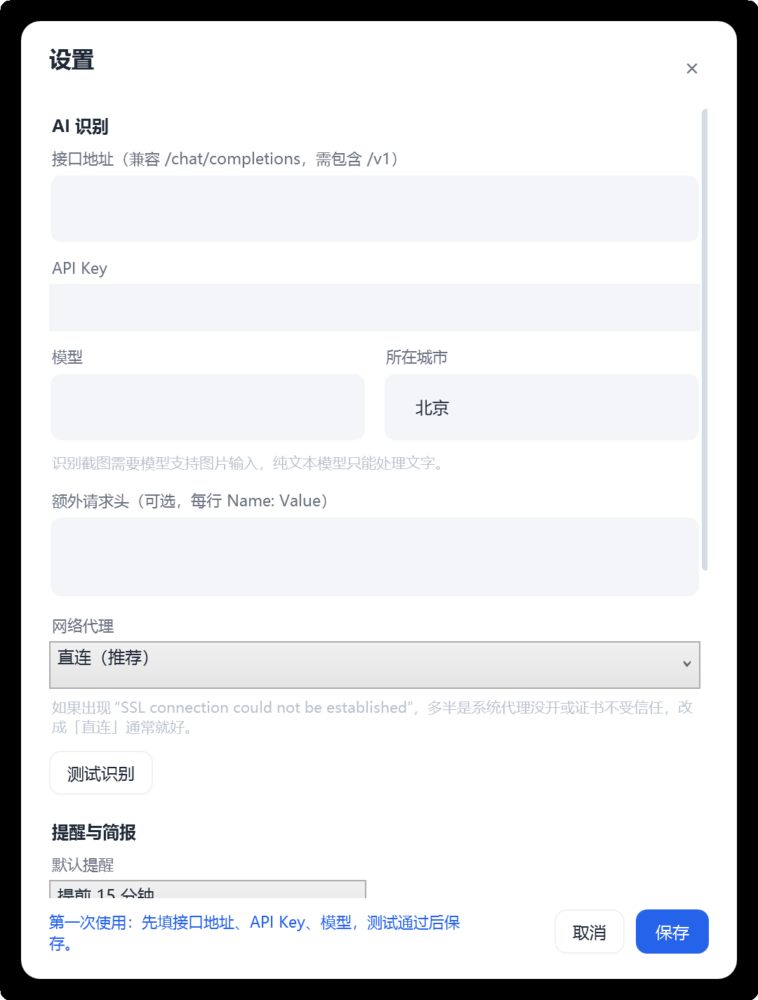

<div align="center">


# EasyDay

**微信群里的通知，几秒变成桌面日程。**

贴在桌面上的月历挂件 · 截图 / 剪贴板 AI 识别 · 到点提醒

[](https://github.com/Jac1024/EasyDay/releases/latest)
[](LICENSE)

[下载](https://github.com/Jac1024/EasyDay/releases/latest) · [快速上手](#快速上手) · [常见问题](#常见问题) · [从源码构建](#从源码构建)

</div>

---

## 它解决什么

群里的活动、会议、值班表，看完就忘；复制到日历又要手动填一堆字段。

EasyDay 的做法是：

1. 复制群通知，按 `Ctrl+Alt+V`（或框选截图按 `Alt+Shift+A`）
2. AI 把时间、地点、提醒提取成**草稿卡**
3. 你核对一下，点「确认并保存」
4. 日程进入桌面挂件，到点弹提醒

**AI 永远不会直接写日历**：所有内容都会先变成可编辑的确认卡；信息模糊时它会追问（"本周四还是下周四？"），有同名日程时会自动标出「已存在」。

全部数据留在本机，不读微信数据库、不注入微信进程。

<div align="center">
  
</div>

## 下载

Windows 10 / 11（x64）。到 [Releases](https://github.com/Jac1024/EasyDay/releases/latest) 下载：

| 包 | 大小 | 适合谁 |
| --- | --- | --- |
| `EasyDay-1.0.0-win-x64.zip` | 几 MB | 已装 **.NET 10 桌面运行时** |
| `EasyDay-1.0.0-win-x64-self-contained.zip` | 约 150 MB | 不想装运行时，解压即用 |

解压后双击 `EasyDay.exe` 即可，免安装。

> **SmartScreen 提示**：程序没有代码签名证书，首次运行可能提示"Windows 已保护你的电脑"。
> 点「更多信息」→「仍要运行」即可。源码全部在本仓库，可自行编译。

## 快速上手

1. **首次启动**会自动打开设置。填 API 接口地址、API Key、模型，点「测试识别」确认能跑通，保存。
   - 默认全部为空，程序不预置任何服务商；接口需兼容 `/chat/completions` 协议，地址要带 `/v1`
   - **看截图必须用视觉模型**；纯文本模型只能处理文字

<div align="center">
  
</div>
2. 把群通知复制到剪贴板，按 `Ctrl+Alt+V`，或点挂件底部「AI 识别剪贴板」
3. 在草稿卡里核对时间、地点，点「确认并保存」
4. 挂件上出现日程；到点会弹提醒

<div align="center">
  
</div>

### 问一句就行：查空闲 / 改期

<div align="center">
  
  
</div>

## 功能

- **桌面挂件**：月历 + 当日议程；**农历 / 节气 / 节日 / 周数**；工作日与周末、节假日**不同底色**（含「休 / 班」标记）；三种显示方式；圆角、贴边吸附、多屏、开机自启、托盘常驻
- **AI 识别**
  - 剪贴板文字 / 图片，截图框选，速记框手动输入
  - 一条消息里多个日程自动拆分
  - 信息模糊时追问，带候选按钮，补充后重新识别
  - 判重：同一天、时间相近、标题相似时标记「已存在」并默认取消勾选
  - 没有配 AI 或断网时，退回本地规则解析（时间、日期仍能识别）
- **问问助手**（`Ctrl+Alt+Q`）：用一句话查空闲、改期、取消
  - 「这周还有空吗」「明天下午有空吗」→ 直接算出空档，并列出已排日程
  - 「把周三的会挪到周四下午」「把评审推迟一小时」→ 先给改期方案（含时长、冲突提示），**确认后才写日历**
  - 「取消周三的项目周会」→ 二次确认后取消
  - 指代不清时列出候选日程，点一个再继续，不瞎猜
- **确认卡**：字段全部可改，低置信度标黄，保留原文可回看
- **提醒**：自绘弹窗「完成 / 10 分钟后 / 打开」；休眠唤醒后补查
- **每日简报**：早报 8:30、晚报 20:00（托盘气泡）
- **冲突检测**：保存时提示时间重叠
- **重复日程**：每天 / 每周 / 每月 / 每年
- **导出 ICS**：一键导入手机或系统日历

## 操作

| 想做的事 | 怎么做 |
| --- | --- |
| 移动 | 按住标题栏拖动，靠近屏幕边缘自动吸附 |
| 缩放 | 拖动任意边缘或右下角；最小 320×520，尺寸会记住 |
| 收起 | 点标题栏 `▾`：只留日期和今日日程，月历、AI 按钮、新建都收起，**上边缘不动**；再点 `▴` 展开 |
| 隐藏到托盘 | 点 `—` 或按 `Esc`；双击托盘图标恢复 |
| 完全退出 | 点 `⏻`，或设置页底部「完全退出 EasyDay」（退出后不再提醒） |
| 切换显示方式 | 右键挂件 →「显示方式」，或设置里改 |

### 显示方式

| 方式 | 行为 |
| --- | --- |
| **嵌入桌面**（默认） | 和桌面图标同层，最像"贴在壁纸上"；普通窗口最大化会盖住它，`Win+D` 回到桌面才看见 |
| 普通窗口 | 普通窗口，可能被其他窗口遮住 |
| 始终置顶 | 浮在所有窗口上方 |

> 嵌入模式用桌面图标列表作为宿主。关掉「显示桌面图标」或资源管理器重启后，程序会在 5 秒内自动重新嵌入；
> 找不到宿主时回退成普通窗口。桌面层的限制决定了挂件是不透明卡片，不支持整体透明度。

## 快捷键

| 功能 | 快捷键 |
| --- | --- |
| AI 识别剪贴板（自动填入速记框） | `Ctrl+Alt+V` |
| 速记（同样自动填入剪贴板内容） | `Ctrl+Alt+Space` |
| 截图识别 | `Alt+Shift+A` |
| 问问助手（查空闲 / 改期 / 取消） | `Ctrl+Alt+Q` |
| 隐藏挂件 | `Esc` |

热键被其他程序占用时只写日志，不影响其他功能。

## 数据与隐私

```
%APPDATA%\EasyDay\
├─ easyday.db                 # SQLite：日程、提醒、草稿留痕、设置
├─ easyday.db.bak-*           # 升级或修复前的自动备份（如有）
└─ logs\app.log               # 运行日志，超过 1MB 自动轮转
```

- **只在本机**：不登录、不上传；AI 请求只把你要识别的那段文字或截图发给你自己配置的接口
- **API Key 加密**：用 Windows DPAPI 按当前用户加密后落盘，换机器/账户后需要重新填写
- **数据库有版本号**：升级时自动备份再改结构；库损坏时备份并重建空库，不会卡在启动失败
- **导出/备份**：设置页可导出 ICS，也可以直接复制 `easyday.db`

### 便携模式

在 `EasyDay.exe` 同目录新建一个空文件 `portable.txt`，数据会放到 `exe\data\`，整个文件夹可以随 U 盘带走。

（也可以用环境变量 `EASYDAY_DATA_DIR` 指定任意目录。）


## 许可证

[MIT](LICENSE)
